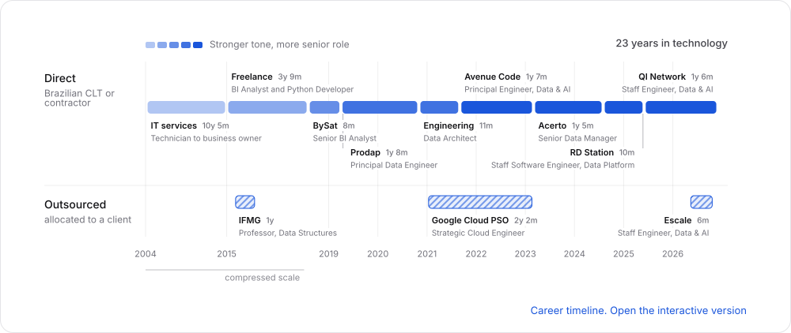
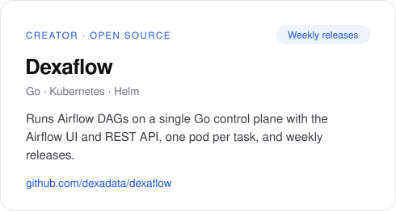
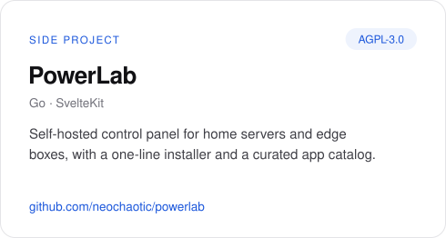
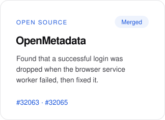
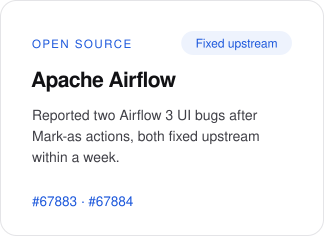
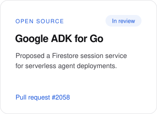
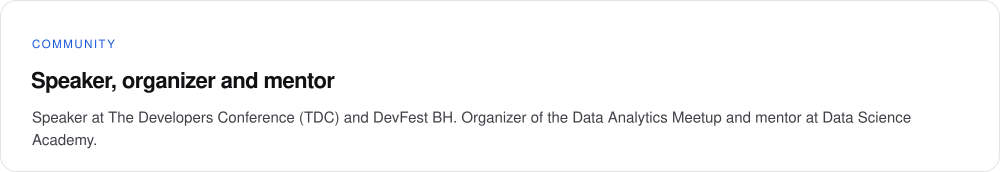

  <picture><source media="(prefers-color-scheme: dark)" srcset="./assets/hero-dark.svg" /><source media="(prefers-color-scheme: light)" srcset="./assets/hero-light.svg" /></picture>

  
  
  
  
  

  <a href="https://neochaotic.github.io/neochaotic/#career-timeline"><picture><source media="(prefers-color-scheme: dark)" srcset="./assets/timeline-dark.svg" /><source media="(prefers-color-scheme: light)" srcset="./assets/timeline-light.svg" /></picture></a>

  <a href="https://github.com/dexadata/dexaflow"><picture><source media="(prefers-color-scheme: dark)" srcset="./assets/card-dexaflow-dark.svg" /><source media="(prefers-color-scheme: light)" srcset="./assets/card-dexaflow-light.svg" /></picture></a>
  <a href="https://github.com/neochaotic/powerlab"><picture><source media="(prefers-color-scheme: dark)" srcset="./assets/card-powerlab-dark.svg" /><source media="(prefers-color-scheme: light)" srcset="./assets/card-powerlab-light.svg" /></picture></a>

  <a href="https://github.com/open-metadata/OpenMetadata/pull/32065"><picture><source media="(prefers-color-scheme: dark)" srcset="./assets/oss-openmetadata-dark.svg" /><source media="(prefers-color-scheme: light)" srcset="./assets/oss-openmetadata-light.svg" /></picture></a>
  <a href="https://github.com/apache/airflow/issues/67883"><picture><source media="(prefers-color-scheme: dark)" srcset="./assets/oss-airflow-dark.svg" /><source media="(prefers-color-scheme: light)" srcset="./assets/oss-airflow-light.svg" /></picture></a>
  <a href="https://github.com/google/adk-go/pull/2058"><picture><source media="(prefers-color-scheme: dark)" srcset="./assets/oss-adk-go-dark.svg" /><source media="(prefers-color-scheme: light)" srcset="./assets/oss-adk-go-light.svg" /></picture></a>

  <picture><source media="(prefers-color-scheme: dark)" srcset="./assets/community-dark.svg" /><source media="(prefers-color-scheme: light)" srcset="./assets/community-light.svg" /></picture>

