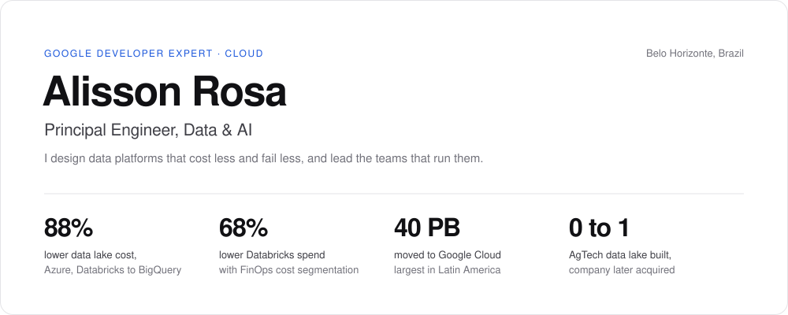

  <picture>
    <source media="(prefers-color-scheme: dark)" srcset="./assets/hero-dark.svg" />
    <source media="(prefers-color-scheme: light)" srcset="./assets/hero-light.svg" />
    
  </picture>

I build data platforms and the systems around them, and I lead the teams that run them.
I created [Dexaflow](https://github.com/dexadata/dexaflow), an Airflow-compatible workflow orchestrator written in Go, and I am a Google Developer Expert in Cloud.

- Cut a fintech data lake's cost by 88% by moving it from Azure and Databricks to BigQuery.
- Cut Databricks cost by 68% on a multi-tenant data platform with FinOps cost segmentation.
- Worked on Latin America's largest big data migration, 40 PB from Hadoop to Google Cloud, as a partner engineer with Google Cloud Professional Services.
- Built an AgTech data lake from zero on AWS, moved it to Google Cloud, and supported the company through its acquisition by a European group.
- Managed data, ML, DevOps and software teams at RD Station, Avenue Code and Acerto.

## Selected work

**[Dexaflow](https://github.com/dexadata/dexaflow)** · Go, Kubernetes, Helm\
Runs Airflow DAGs on a single Go control plane with the Airflow UI and REST API, one pod per task, and weekly releases. [Docs](https://dexaflow.dexadata.ai/) · [DexaData](https://dexadata.ai)

**[PowerLab](https://github.com/neochaotic/powerlab)** · Go, SvelteKit\
Self-hosted control panel for home servers and edge boxes, with a one-line installer and a curated app catalog.

## Open source

**OpenMetadata**\
Found that a successful login was silently dropped when the browser service worker failed ([#32063](https://github.com/open-metadata/OpenMetadata/issues/32063)), then fixed it ([#32065](https://github.com/open-metadata/OpenMetadata/pull/32065), merged).\
Reported a Unity Catalog ingestion gap for BROWSE-only objects ([#33505](https://github.com/open-metadata/OpenMetadata/issues/33505)).

**Apache Airflow**\
Reported two Airflow 3 UI bugs after Mark-as actions, both fixed upstream within a week ([#67883](https://github.com/apache/airflow/issues/67883), [#67884](https://github.com/apache/airflow/issues/67884)).\
Shared a design note on secret masking for the Go SDK ([#67599](https://github.com/apache/airflow/issues/67599)).

**Google ADK for Go**\
Proposed a Firestore session service for serverless agent deployments ([#2058](https://github.com/google/adk-go/pull/2058), under review).

## Community

Speaker at The Developers Conference (TDC) and DevFest BH. Organizer of the Data Analytics Meetup and mentor at Data Science Academy.

---

[Resume (PDF)](https://neochaotic.github.io/neochaotic/Alisson_Rosa_CV_EN.pdf) · [Currículo (PDF)](https://neochaotic.github.io/neochaotic/Alisson_Rosa_CV_PT.pdf) · [Web CV](https://neochaotic.github.io/neochaotic/) · [LinkedIn](https://www.linkedin.com/in/alissonrosa/) · [Email](mailto:alisson.david.rosa@gmail.com)
