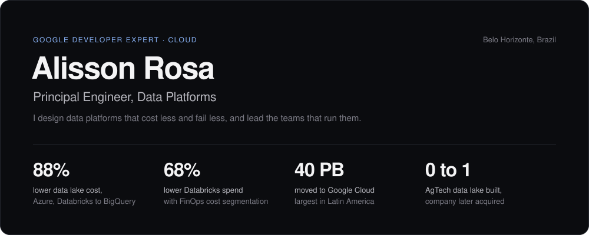
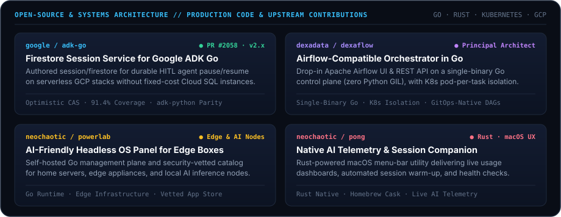

<picture>
  <source media="(prefers-color-scheme: dark)" srcset="./assets/hero-dark.svg" />
  <source media="(prefers-color-scheme: light)" srcset="./assets/hero-light.svg" />
  
</picture>

 

**[↗ Interactive Public Curriculum & Architecture Dossier (EN / PT-BR)](https://neochaotic.github.io/neochaotic/)** &nbsp;·&nbsp; **[LinkedIn](https://www.linkedin.com/in/alissonrosa/)** &nbsp;·&nbsp; **[Instagram (@neoChaotic)](https://www.instagram.com/neoChaotic/)** &nbsp;·&nbsp; **[alisson.david.rosa@gmail.com](mailto:alisson.david.rosa@gmail.com)**

---

### Selected Systems & Open-Source Contributions

<picture>
  <source media="(prefers-color-scheme: dark)" srcset="./assets/bento-dark.svg" />
  <source media="(prefers-color-scheme: light)" srcset="./assets/bento-light.svg" />
  
</picture>

| System / Repository | Architectural Scope & Engineering Highlights | Links |
| :--- | :--- | :--- |
| **[`google/adk-go`](https://github.com/google/adk-go)** *Google Agent Development Kit (Go v2)* | Designed and implemented `google.golang.org/adk/session/firestore` to enable durable human-in-the-loop (`RequestInput` / `Resume`) agent workflows on serverless GCP stacks (`Cloud Run` + `Firestore` + `Eventarc`) without requiring fixed-cost Cloud SQL instances. Features optimistic CAS transactions, context-aware per-session semaphores, 3-tier state scoping (`app:`, `user:`, session), microsecond timestamp determinism, and **91.4% statement coverage**. | [PR #2058](https://github.com/google/adk-go/pull/2058) · [Issue #2057](https://github.com/google/adk-go/issues/2057) |
| **[`dexadata/dexaflow`](https://github.com/dexadata/dexaflow)** *Workflow Orchestrator in Go* | Apache Airflow-compatible workflow orchestrator re-engineered in Go: drop-in Airflow UI and REST API running on a single-binary control plane (eliminating Python GIL scheduling bottlenecks), with pod-per-task Kubernetes isolation and GitOps-native DAGs. | [Showcase](https://github.com/neochaotic/dexaflow-showcase) · [Docs](https://dexaflow.dexadata.ai) |
| **[`neochaotic/powerlab`](https://github.com/neochaotic/powerlab)** *Headless OS & Edge Control Plane* | Self-hosted, AI-friendly Go control plane and security-vetted application catalog for managing home servers, edge boxes, and local inference nodes. | [Repo](https://github.com/neochaotic/powerlab) · [Catalog](https://github.com/neochaotic/powerlab-store) |
| **[`neochaotic/pong`](https://github.com/neochaotic/pong)** *Rust Native Developer Tooling* | Native macOS menu-bar companion written in Rust providing live AI usage telemetry, automated session warm-up, and health checks. | [Repo](https://github.com/neochaotic/pong) · [Homebrew Tap](https://github.com/neochaotic/homebrew-pong) |

---

### Google Ecosystem & Technical Advisory

- **Google Developer Expert (GDE) — Cloud & AI**: Recognized by Google for deep architectural expertise across Google Cloud Platform, distributed data platforms, and production Generative AI systems.
- **Gemini Product Feedback Collaborator**: Active participant in Google's early-access and developer feedback loops—stress-testing preview Gemini models, structured outputs, tool-calling ergonomics, and Agent Development Kit (ADK) runtimes against real enterprise workloads.
- **Production Architecture Matrix**:
  - **Runtimes & Systems**: `Go (1.26+)`, `Python`, `Rust`, `gRPC`, `Protocol Buffers`, `Concurrent State Machines`
  - **Agentic & AI Infrastructure**: `Google ADK (Go / Python)`, `Gemini API`, `Vertex AI`, `Model Context Protocol (MCP)`, `A2A`, `HITL Workflows`
  - **Cloud & Serverless**: `Google Cloud Run`, `Firestore`, `BigQuery`, `Eventarc`, `Cloud Tasks`, `GKE`, `IAM / KMS`
  - **Data & Orchestration**: `Dexaflow`, `Apache Airflow`, `OpenMetadata`, `Apache Spark / Dataproc`, `ClickHouse`, `PostgreSQL`

---

  Belo Horizonte, MG — Brazil · <a href="https://neochaotic.github.io/neochaotic/">Public Curriculum Vitae (EN / PT-BR)</a> · <a href="https://www.linkedin.com/in/alissonrosa/">LinkedIn</a> · <a href="https://www.instagram.com/neoChaotic/">@neoChaotic</a>

