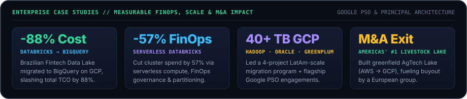
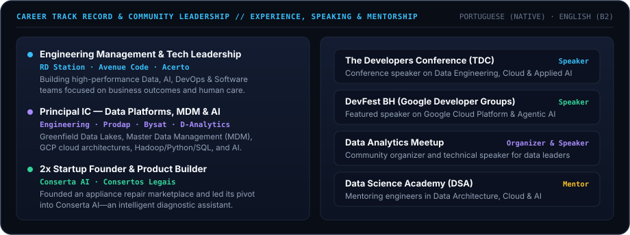
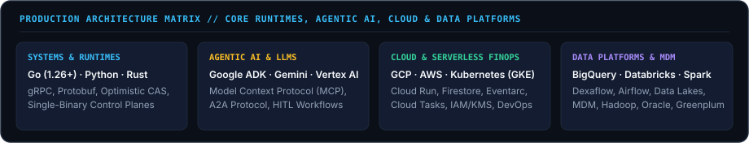

  <picture>
    <source media="(prefers-color-scheme: dark)" srcset="./assets/hero-dark.svg" />
    <source media="(prefers-color-scheme: light)" srcset="./assets/hero-light.svg" />
    
  </picture>

  <a href="https://neochaotic.github.io/neochaotic/"><b>↗ Interactive Web CV</b></a> &nbsp;·&nbsp;
  <a href="https://neochaotic.github.io/neochaotic/Alisson_Rosa_CV_EN.pdf"><b>⬇ ATS Resume PDF (EN)</b></a> &nbsp;·&nbsp;
  <a href="https://neochaotic.github.io/neochaotic/Alisson_Rosa_CV_PT.pdf"><b>⬇ Currículo ATS PDF (PT-BR)</b></a> &nbsp;·&nbsp;
  <a href="https://me.developers.google.com/communities/experts?q=alisson%20rosa"><b>✦ Verified GDE Directory</b></a> &nbsp;·&nbsp;
  <a href="https://me.developers.google.com/u/neoChaotic"><b>Google Dev Profile</b></a> &nbsp;·&nbsp;
  <a href="https://www.linkedin.com/in/alissonrosa/"><b>LinkedIn</b></a> &nbsp;·&nbsp;
  <a href="https://www.instagram.com/neoChaotic/"><b>@neoChaotic</b></a>

  <picture>
    <source media="(prefers-color-scheme: dark)" srcset="./assets/impact-dark.svg" />
    <source media="(prefers-color-scheme: light)" srcset="./assets/impact-light.svg" />
    
  </picture>

  <picture>
    <source media="(prefers-color-scheme: dark)" srcset="./assets/bento-dark.svg" />
    <source media="(prefers-color-scheme: light)" srcset="./assets/bento-light.svg" />
    
  </picture>

  
    <b>Direct Repository &amp; PR Links:</b> &nbsp;
    <a href="https://github.com/google/adk-go/pull/2058"><code>google/adk-go</code> (PR #2058 · Issue #2057)</a> &nbsp;·&nbsp;
    <a href="https://github.com/dexadata/dexaflow"><code>dexadata/dexaflow</code></a> &nbsp;·&nbsp;
    <a href="https://github.com/neochaotic/powerlab"><code>neochaotic/powerlab</code></a> &nbsp;·&nbsp;
    <a href="https://github.com/neochaotic/pong"><code>neochaotic/pong</code></a>
  

  <picture>
    <source media="(prefers-color-scheme: dark)" srcset="./assets/trajectory-dark.svg" />
    <source media="(prefers-color-scheme: light)" srcset="./assets/trajectory-light.svg" />
    
  </picture>

  <picture>
    <source media="(prefers-color-scheme: dark)" srcset="./assets/stack-dark.svg" />
    <source media="(prefers-color-scheme: light)" srcset="./assets/stack-light.svg" />
    
  </picture>

  
    Belo Horizonte, MG — Brazil &nbsp;·&nbsp;
    <a href="https://neochaotic.github.io/neochaotic/">Interactive CV</a> &nbsp;·&nbsp;
    <a href="https://neochaotic.github.io/neochaotic/Alisson_Rosa_CV_EN.pdf">PDF (EN)</a> &nbsp;·&nbsp;
    <a href="https://neochaotic.github.io/neochaotic/Alisson_Rosa_CV_PT.pdf">PDF (PT-BR)</a> &nbsp;·&nbsp;
    <a href="mailto:alisson.david.rosa@gmail.com">alisson.david.rosa@gmail.com</a>
  

